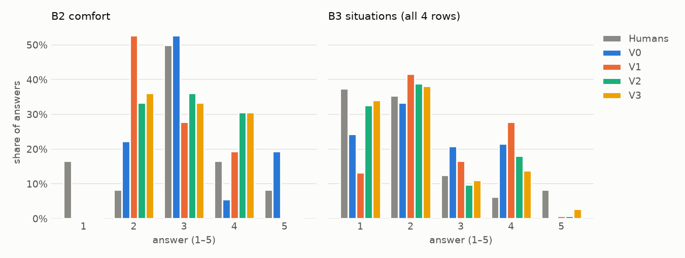

# Smoke test report

`pilot: true` — feasibility check with 3 participants; no conclusions about the hypotheses.

- Runs: `20261015-114158_claude-haiku-4.5`
- Model: `anthropic/claude-haiku-4.5` · temperature 0.7 · 3 runs per condition · provider routing {'zdr': True, 'data_collection': 'deny'} · codebook 2026-10-14
- Versions: V0, V1, V2, V3 · participants: 3 · places: 4

## Summary

- **Pipeline:** 144 calls answered end to end; 144/144 answers valid (5 needed a retry).
- **Scale use (B2):** humans used 1, 2, 3, 4, 5; personas used V0: 2, 3, 4, 5 (53% 3s); V1: 2, 3, 4 (28% 3s); V2: 2, 3, 4 (36% 3s); V3: 2, 3, 4 (33% 3s).
- **B2 error by version** (mean abs. error, 1–5 scale): V0 0.64, V1 0.75, V2 0.72, V3 0.75. With 3 participants this is a feasibility check, not a result.
- **Time and cost:** median 5.6 s and $0.0045 per call.
- _To add after reading: what to fix before the real run (format, instructions, limits only)._

## 1. Format

- Valid answers: **144 / 144** answered calls (100%).
- Calls retried once for an invalid answer: 5 (5 became valid on retry).
- API errors before an answer came through (not format problems; the call was done again):
  - API error: APIStatusError: Error code: 402 - {'error': {'message': 'This request would ex… (3×)
  - API error: RateLimitError: Error code: 429 - {'error': {'message': 'Rate limit exceeded: … (1×)
- First-attempt errors that triggered a retry:
  - B5_elements_bother: 'none' must be the only code when chosen (1×)
  - B6_elements_feel_good: ['water_or_fountains', 'trees_and_greenery', 'shade', 'wide_open_space'] is too long (1×)
  - B5_elements_bother: ['many_people', 'direct_sun_little_shade', 'hard_surfaces', 'stalls_shops_or_cafes'] is too long (1×)
  - B5_elements_bother: ['many_people', 'direct_sun_little_shade', 'signs_and_ads', 'hard_surfaces'] is too long (1×)
  - B6_elements_feel_good: ['water_or_fountains', 'trees_and_greenery', 'wide_open_space', 'pedestrian_area_no_traffic'] is too long (1×)
- Invalid after retry: none.
- Model ids returned by the API: {'anthropic/claude-haiku-4.5': 144}; providers: {'Amazon Bedrock': 149}; finish reasons: {'stop': 149}.

## 2. Scale use

| Q | Who | n | 1 | 2 | 3 | 4 | 5 | share of 3 | share of 1 or 5 |
|---|---|---|---|---|---|---|---|---|---|
| B2 | Humans | 12 | 2 | 1 | 6 | 2 | 1 | 50% | 25% |
| B2 | V0 | 36 | 0 | 8 | 19 | 2 | 7 | 53% | 19% |
| B2 | V1 | 36 | 0 | 19 | 10 | 7 | 0 | 28% | 0% |
| B2 | V2 | 36 | 0 | 12 | 13 | 11 | 0 | 36% | 0% |
| B2 | V3 | 36 | 0 | 13 | 12 | 11 | 0 | 33% | 0% |
| B3 | Humans | 48 | 18 | 17 | 6 | 3 | 4 | 12% | 46% |
| B3 | V0 | 144 | 35 | 48 | 30 | 31 | 0 | 21% | 24% |
| B3 | V1 | 144 | 19 | 60 | 24 | 40 | 1 | 17% | 14% |
| B3 | V2 | 144 | 47 | 56 | 14 | 26 | 1 | 10% | 33% |
| B3 | V3 | 144 | 49 | 55 | 16 | 20 | 4 | 11% | 37% |

## 3. Scores

Scores per participant and version, averaged over places and runs. ↑ higher is better, ↓ lower is better. Errors are on the 1–5 scale; Jaccard is 0 (no overlap) to 1 (same selection).

| Participant | Version | B2 Spearman ρ (4 places) ↑ | B2 abs. error ↓ | B3 MAE ↓ | B4 Jaccard ↑ | B5 Jaccard ↑ | B6 Jaccard ↑ | B7 Jaccard ↑ |
|---|---|---|---|---|---|---|---|---|
| P01 | V0 | 0.00 | 0.83 | 0.90 | 0.16 | 0.41 | 0.23 | 0.30 |
| P01 | V1 | -0.27 | 0.75 | 1.04 | 0.28 | 0.25 | 0.28 | 0.28 |
| P01 | V2 | -0.27 | 0.67 | 0.40 | 0.27 | 0.49 | 0.13 | 0.18 |
| P01 | V3 | -0.26 | 0.75 | 0.38 | 0.27 | 0.50 | 0.15 | 0.21 |
| P02 | V0 | 0.95 | 0.50 | 0.52 | 0.28 | 0.57 | 0.33 | 0.30 |
| P02 | V1 | 0.95 | 1.00 | 0.60 | 0.24 | 0.51 | 0.35 | 0.33 |
| P02 | V2 | 0.95 | 1.00 | 0.56 | 0.35 | 0.41 | 0.31 | 0.35 |
| P02 | V3 | 0.95 | 1.00 | 0.52 | 0.35 | 0.60 | 0.35 | 0.50 |
| P03 | V0 | 0.95 | 0.58 | 0.94 | 0.20 | 0.14 | 0.37 | 0.30 |
| P03 | V1 | 0.83 | 0.50 | 0.94 | 0.20 | 0.17 | 0.44 | 0.25 |
| P03 | V2 | 0.83 | 0.50 | 0.75 | 0.51 | 0.38 | 0.40 | 0.29 |
| P03 | V3 | 0.83 | 0.50 | 0.92 | 0.55 | 0.46 | 0.40 | 0.26 |
| **all** | **V0** | 0.63 | **0.64** | **0.78** | **0.21** | **0.38** | **0.31** | **0.30** |
| **all** | **V1** | 0.50 | **0.75** | **0.86** | **0.24** | **0.31** | **0.36** | **0.28** |
| **all** | **V2** | 0.50 | **0.72** | **0.57** | **0.38** | **0.43** | **0.28** | **0.27** |
| **all** | **V3** | 0.51 | **0.75** | **0.60** | **0.39** | **0.52** | **0.30** | **0.32** |

## 4. Stability

Run-to-run spread within each participant × version × place (3 runs), averaged. Run agreement = mean Jaccard between the runs' selections (1 = identical choices every run).

| Version | B2 SD over runs | places with identical B2 in all runs | B3 SD over runs | B4 run agreement | B5 run agreement | B6 run agreement | B7 run agreement |
|---|---|---|---|---|---|---|---|
| V0 | 0.20 | 7/12 | 0.08 | 0.86 | 0.70 | 0.83 | 0.73 |
| V1 | 0.08 | 10/12 | 0.09 | 0.86 | 0.63 | 0.77 | 0.72 |
| V2 | 0.04 | 11/12 | 0.09 | 0.84 | 0.71 | 0.69 | 0.70 |
| V3 | 0.08 | 10/12 | 0.08 | 0.89 | 0.69 | 0.74 | 0.78 |

**Option order.** B4–B7 options were shuffled in every call. If the shown order did not matter, the chosen options would sit on average in the middle of the shuffled list (0.50; 0 = first, 1 = last). Values well below 0.50 mean the model tends to pick options shown first.

| Question | mean relative position of chosen options | choices |
|---|---|---|
| B4 | 0.50 | 389 |
| B5 | 0.46 | 314 |
| B6 | 0.46 | 415 |
| B7 | 0.48 | 388 |

## 4b. Bias, copying the profile, diversity

**Bias** = signed error, persona − person, averaged over participants, places and runs. **B2:** negative = the persona feels *less comfortable* than the person. **B3:** positive = the persona sees *more problems* than the person. Near 0 = no systematic shift (errors may still be large in both directions; see section 3).

| Version | B2 signed error | B3 signed error |
|---|---|---|
| V0 | 0.31 | 0.27 |
| V1 | -0.25 | 0.49 |
| V2 | 0.06 | 0.03 |
| V3 | 0.03 | 0.01 |

**Copying the profile.** B3 asks the same 4 situations as Q15, and Q15 is in the V2/V3 persona text; B4 asks the same senses as Q16. The last row is what you get with no model and no photo: B3 = the person's own Q15 answers for every place, B4 = the 3 senses they rated highest in Q16. A version only shows perception of the place if it does **better** than this row. *B3 distance to Q15*: how close the persona's B3 is to the person's Q15 (near 0 = it copies the profile instead of judging the place).

| Version | B3 error vs person ↓ | B3 distance to own Q15 | B4 Jaccard ↑ |
|---|---|---|---|
| V0 | 0.78 | 1.23 | 0.21 |
| V1 | 0.86 | 1.22 | 0.24 |
| V2 | 0.57 | 1.01 | 0.38 |
| V3 | 0.60 | 0.99 | 0.39 |
| **profile only, no model** | **1.29** | 0.00 | **0.31** |

For B2, always answering 3 gives an error of **0.75** (compare with section 3).

**Diversity** = how much the answers differ *between participants* for the same place. SD across participants for B2/B3 (higher = more different); Jaccard between participants for B4–B7 (lower = more different). A version is as diverse as the people when its row is close to the Humans row; a version that gives everyone the same answer has SD near 0 and Jaccard near 1. Diversity alone is not accuracy: random answers are diverse too.

| Who | B2 SD between | B3 SD between | B4 Jaccard between | B5 Jaccard between | B6 Jaccard between | B7 Jaccard between |
|---|---|---|---|---|---|---|
| **Humans** | 0.64 | 0.63 | 0.49 | 0.32 | 0.44 | 0.22 |
| V0 | 0.12 | 0.05 | 0.82 | 0.70 | 0.83 | 0.75 |
| V1 | 0.12 | 0.10 | 0.72 | 0.47 | 0.73 | 0.57 |
| V2 | 0.31 | 0.50 | 0.51 | 0.54 | 0.62 | 0.52 |
| V3 | 0.27 | 0.49 | 0.58 | 0.65 | 0.64 | 0.55 |

## 5. Time and cost

- Seconds per call (incl. retries): median **5.6**, max 11.4.
- Cost per call: mean **$0.0045**; total $0.6432 for 144 calls.
- Projection for 40 participants × 4 places × 3 runs × 3 versions = 1440 calls: about **$6.43** and **2.3 h** one call at a time.
- Projection for 40 participants × 4 places × 3 runs × 4 versions = 1920 calls: about **$8.58** and **3.0 h** one call at a time.

## 6. Reasoning samples

For each participant, one reasoning per version for place P1, run 1, verbatim, in [`reasoning_samples.md`](reasoning_samples.md) (kept out of git because it can repeat health information).

## 7. Do the versions really differ?

**2 × 2 view.** Each row adds one factor while the other stays fixed. In every change column, **negative = better**: closer to the person (error) or less systematic shift (bias = size of the signed error in section 4b).

|               | No sensory info | Sensory info |
|---|---|---|
| **No labels** | V0 | V3 |
| **Labels** | V1 | V2 |

| Adding |  | Versions | B2 abs. error change | B3 MAE change | B2 bias change | B3 bias change |
|---|---|---|---|---|---|---|
| + Labels | without sensory info | V0 → V1 | +0.11 | +0.08 | -0.06 | +0.22 |
| + Labels | with sensory info | V3 → V2 | -0.03 | -0.03 | +0.03 | +0.02 |
| + Sensory info | without labels | V0 → V3 | +0.11 | -0.18 | -0.28 | -0.26 |
| + Sensory info | with labels | V1 → V2 | -0.03 | -0.29 | -0.19 | -0.46 |

**Beyond run-to-run noise?** For each participant and place, the difference between two versions' mean answers (over 3 runs) is compared with the run-to-run noise. **B2 noise** = the larger of the two versions' ranges over runs (max − min). **B3 noise** = twice the larger SD over runs of the mean B3 score. A difference counts only if it is larger than the noise.

| Comparison | B2: differs beyond noise | B3: differs beyond noise |
|---|---|---|
| V0 vs V1 | 4/12 | 4/12 |
| V0 vs V2 | 2/12 | 6/12 |
| V0 vs V3 | 2/12 | 6/12 |
| V1 vs V2 | 2/12 | 5/12 |
| V1 vs V3 | 1/12 | 8/12 |
| V2 vs V3 | 0/12 | 3/12 |

Every comparison

| Participant | Place | Versions | B2: |difference of means| vs noise | beyond noise? | B3: |difference of means| vs noise | beyond noise? |
|---|---|---|---|---|---|---|
| P01 | P1 | V0 vs V1 | 1.00 vs 0.00 | **yes** | 0.17 vs 0.47 | no |
| P01 | P1 | V0 vs V2 | 0.00 vs 0.00 | no | 1.17 vs 0.24 | **yes** |
| P01 | P1 | V0 vs V3 | 0.00 vs 0.00 | no | 1.25 vs 0.41 | **yes** |
| P01 | P1 | V1 vs V2 | 1.00 vs 0.00 | **yes** | 1.33 vs 0.47 | **yes** |
| P01 | P1 | V1 vs V3 | 1.00 vs 0.00 | **yes** | 1.42 vs 0.47 | **yes** |
| P01 | P1 | V2 vs V3 | 0.00 vs 0.00 | no | 0.08 vs 0.41 | no |
| P01 | P2 | V0 vs V1 | 1.33 vs 1.00 | **yes** | 0.58 vs 0.24 | **yes** |
| P01 | P2 | V0 vs V2 | 0.67 vs 1.00 | no | 0.08 vs 0.24 | no |
| P01 | P2 | V0 vs V3 | 0.67 vs 1.00 | no | 0.08 vs 0.24 | no |
| P01 | P2 | V1 vs V2 | 0.67 vs 1.00 | no | 0.67 vs 0.24 | **yes** |
| P01 | P2 | V1 vs V3 | 0.67 vs 1.00 | no | 0.67 vs 0.24 | **yes** |
| P01 | P2 | V2 vs V3 | 0.00 vs 0.00 | no | 0.00 vs 0.00 | no |
| P01 | P3 | V0 vs V1 | 0.33 vs 1.00 | no | 0.08 vs 0.62 | no |
| P01 | P3 | V0 vs V2 | 0.67 vs 1.00 | no | 0.92 vs 0.24 | **yes** |
| P01 | P3 | V0 vs V3 | 0.67 vs 1.00 | no | 1.08 vs 0.24 | **yes** |
| P01 | P3 | V1 vs V2 | 1.00 vs 1.00 | no | 1.00 vs 0.62 | **yes** |
| P01 | P3 | V1 vs V3 | 1.00 vs 1.00 | no | 1.17 vs 0.62 | **yes** |
| P01 | P3 | V2 vs V3 | 0.00 vs 1.00 | no | 0.17 vs 0.24 | no |
| P01 | P4 | V0 vs V1 | 0.33 vs 1.00 | no | 0.25 vs 0.71 | no |
| P01 | P4 | V0 vs V2 | 0.67 vs 1.00 | no | 1.33 vs 0.71 | **yes** |
| P01 | P4 | V0 vs V3 | 0.33 vs 1.00 | no | 1.00 vs 0.71 | **yes** |
| P01 | P4 | V1 vs V2 | 1.00 vs 0.00 | **yes** | 1.58 vs 0.24 | **yes** |
| P01 | P4 | V1 vs V3 | 0.67 vs 1.00 | no | 1.25 vs 0.00 | **yes** |
| P01 | P4 | V2 vs V3 | 0.33 vs 1.00 | no | 0.33 vs 0.24 | **yes** |
| P02 | P1 | V0 vs V1 | 1.00 vs 0.00 | **yes** | 0.25 vs 0.24 | **yes** |
| P02 | P1 | V0 vs V2 | 1.00 vs 0.00 | **yes** | 0.42 vs 0.24 | **yes** |
| P02 | P1 | V0 vs V3 | 1.00 vs 0.00 | **yes** | 0.67 vs 0.24 | **yes** |
| P02 | P1 | V1 vs V2 | 0.00 vs 0.00 | no | 0.17 vs 0.24 | no |
| P02 | P1 | V1 vs V3 | 0.00 vs 0.00 | no | 0.42 vs 0.24 | **yes** |
| P02 | P1 | V2 vs V3 | 0.00 vs 0.00 | no | 0.25 vs 0.24 | **yes** |
| P02 | P2 | V0 vs V1 | 1.00 vs 0.00 | **yes** | 0.58 vs 0.24 | **yes** |
| P02 | P2 | V0 vs V2 | 1.00 vs 0.00 | **yes** | 0.50 vs 0.41 | **yes** |
| P02 | P2 | V0 vs V3 | 1.00 vs 0.00 | **yes** | 0.33 vs 0.24 | **yes** |
| P02 | P2 | V1 vs V2 | 0.00 vs 0.00 | no | 0.08 vs 0.41 | no |
| P02 | P2 | V1 vs V3 | 0.00 vs 0.00 | no | 0.25 vs 0.24 | **yes** |
| P02 | P2 | V2 vs V3 | 0.00 vs 0.00 | no | 0.17 vs 0.41 | no |
| P02 | P3 | V0 vs V1 | 0.00 vs 0.00 | no | 0.00 vs 0.00 | no |
| P02 | P3 | V0 vs V2 | 0.00 vs 0.00 | no | 0.08 vs 0.24 | no |
| P02 | P3 | V0 vs V3 | 0.00 vs 0.00 | no | 0.17 vs 0.24 | no |
| P02 | P3 | V1 vs V2 | 0.00 vs 0.00 | no | 0.08 vs 0.24 | no |
| P02 | P3 | V1 vs V3 | 0.00 vs 0.00 | no | 0.17 vs 0.24 | no |
| P02 | P3 | V2 vs V3 | 0.00 vs 0.00 | no | 0.08 vs 0.24 | no |
| P02 | P4 | V0 vs V1 | 0.00 vs 0.00 | no | 0.00 vs 0.00 | no |
| P02 | P4 | V0 vs V2 | 0.00 vs 0.00 | no | 0.00 vs 0.00 | no |
| P02 | P4 | V0 vs V3 | 0.00 vs 0.00 | no | 0.00 vs 0.00 | no |
| P02 | P4 | V1 vs V2 | 0.00 vs 0.00 | no | 0.00 vs 0.00 | no |
| P02 | P4 | V1 vs V3 | 0.00 vs 0.00 | no | 0.00 vs 0.00 | no |
| P02 | P4 | V2 vs V3 | 0.00 vs 0.00 | no | 0.00 vs 0.00 | no |
| P03 | P1 | V0 vs V1 | 0.67 vs 1.00 | no | 0.08 vs 0.24 | no |
| P03 | P1 | V0 vs V2 | 0.67 vs 1.00 | no | 0.00 vs 0.00 | no |
| P03 | P1 | V0 vs V3 | 0.67 vs 1.00 | no | 0.00 vs 0.00 | no |
| P03 | P1 | V1 vs V2 | 0.00 vs 0.00 | no | 0.08 vs 0.24 | no |
| P03 | P1 | V1 vs V3 | 0.00 vs 0.00 | no | 0.08 vs 0.24 | no |
| P03 | P1 | V2 vs V3 | 0.00 vs 0.00 | no | 0.00 vs 0.00 | no |
| P03 | P2 | V0 vs V1 | 0.67 vs 1.00 | no | 0.25 vs 0.00 | **yes** |
| P03 | P2 | V0 vs V2 | 0.67 vs 1.00 | no | 0.17 vs 0.24 | no |
| P03 | P2 | V0 vs V3 | 0.67 vs 1.00 | no | 0.17 vs 0.47 | no |
| P03 | P2 | V1 vs V2 | 0.00 vs 0.00 | no | 0.08 vs 0.24 | no |
| P03 | P2 | V1 vs V3 | 0.00 vs 0.00 | no | 0.08 vs 0.47 | no |
| P03 | P2 | V2 vs V3 | 0.00 vs 0.00 | no | 0.00 vs 0.47 | no |
| P03 | P3 | V0 vs V1 | 0.00 vs 0.00 | no | 0.08 vs 0.24 | no |
| P03 | P3 | V0 vs V2 | 0.00 vs 0.00 | no | 0.50 vs 0.00 | **yes** |
| P03 | P3 | V0 vs V3 | 0.00 vs 0.00 | no | 0.50 vs 0.00 | **yes** |
| P03 | P3 | V1 vs V2 | 0.00 vs 0.00 | no | 0.58 vs 0.24 | **yes** |
| P03 | P3 | V1 vs V3 | 0.00 vs 0.00 | no | 0.58 vs 0.24 | **yes** |
| P03 | P3 | V2 vs V3 | 0.00 vs 0.00 | no | 0.00 vs 0.00 | no |
| P03 | P4 | V0 vs V1 | 0.33 vs 1.00 | no | 0.25 vs 0.71 | no |
| P03 | P4 | V0 vs V2 | 0.33 vs 1.00 | no | 0.08 vs 0.71 | no |
| P03 | P4 | V0 vs V3 | 0.33 vs 1.00 | no | 0.25 vs 0.71 | no |
| P03 | P4 | V1 vs V2 | 0.00 vs 0.00 | no | 0.17 vs 0.24 | no |
| P03 | P4 | V1 vs V3 | 0.00 vs 0.00 | no | 0.50 vs 0.00 | **yes** |
| P03 | P4 | V2 vs V3 | 0.00 vs 0.00 | no | 0.33 vs 0.24 | **yes** |

