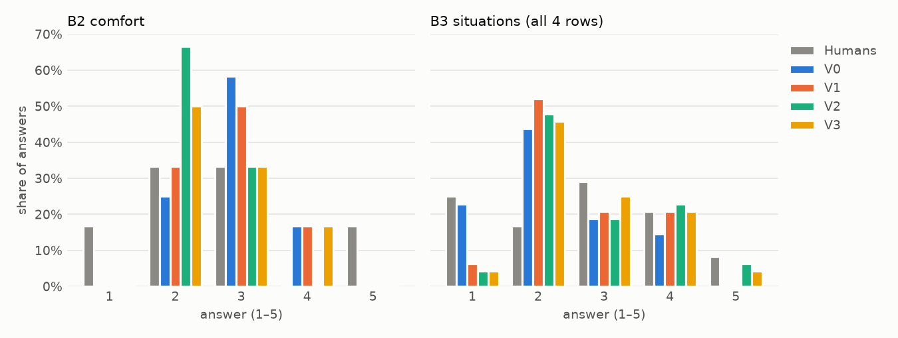

# Pilot report: pilot2

`pilot: true` — 1 participant; no conclusions about the hypotheses.

- Runs: `20261015-181731_claude-haiku-4.5_pilot2`
- Model: `anthropic/claude-haiku-4.5` · temperature 0.7 · 2 runs per condition · provider routing {'zdr': True, 'data_collection': 'deny'} · codebook config\pilot2\codebook2.yaml (version 2026-10-15)
- Versions: V0, V1, V2, V3 · participants: 1 · places: 6

## 1. Summary

- **Pipeline:** 48 calls answered; 48/48 valid (2 needed a retry).
- **B3 (primary), mean error:** V0 0.67, V1 0.69, V2 0.67, V3 0.62; copy Part A 1.38, chance 1.54.
- **Bias (B3 signed):** V0 -0.46, V1 -0.15, V2 0.08, V3 0.04 (positive = persona sees more problems than the person).
- **Scale use (B2):** humans 1, 2, 3, 5; V0 2, 3, 4; V1 2, 3, 4; V2 2, 3; V3 2, 3, 4.
- **Time and cost:** median 5.7 s and $0.0036 per call.
- With 1 participant this is a feasibility check, not a result.
- _To add after reading: what to fix before the real run (format, instructions, limits only)._

## 2. Format

- Valid answers: **48 / 48** answered calls (100%).
- Retried once for an invalid answer: 2 (2 valid on retry). **More than 3 items** (the smoke test's most common error, before "Choose 1 to 3"): 2.
- First-attempt errors that triggered a retry:
  - B6_changes: ['hearing', 'touch_temperature', 'recovery', 'space'] is too long (1×)
  - B6_changes: ['space', 'hearing', 'recovery', 'body_in_space'] is too long (1×)
- Invalid after retry: 0
- Model ids returned by the API: {'anthropic/claude-haiku-4.5': 48}; providers: {'Amazon Bedrock': 50}.
- Option order (shuffled each call): mean relative position of the chosen options, 0.50 = order has no effect, lower = first options favoured: B4 0.48, B5 0.54, B6 0.48.

## 3. Scale use

| Q | Who | n | 1 | 2 | 3 | 4 | 5 | share of 3 | share of 1 or 5 |
|---|---|---|---|---|---|---|---|---|---|
| B2 | Humans | 6 | 1 | 2 | 2 | 0 | 1 | 33% | 33% |
| B2 | V0 | 12 | 0 | 3 | 7 | 2 | 0 | 58% | 0% |
| B2 | V1 | 12 | 0 | 4 | 6 | 2 | 0 | 50% | 0% |
| B2 | V2 | 12 | 0 | 8 | 4 | 0 | 0 | 33% | 0% |
| B2 | V3 | 12 | 0 | 6 | 4 | 2 | 0 | 33% | 0% |
| B3 | Humans | 24 | 6 | 4 | 7 | 5 | 2 | 29% | 33% |
| B3 | V0 | 48 | 11 | 21 | 9 | 7 | 0 | 19% | 23% |
| B3 | V1 | 48 | 3 | 25 | 10 | 10 | 0 | 21% | 6% |
| B3 | V2 | 48 | 2 | 23 | 9 | 11 | 3 | 19% | 10% |
| B3 | V3 | 48 | 2 | 22 | 12 | 10 | 2 | 25% | 8% |

## 4. Scores and baselines

Scores per participant and version, averaged over places and runs, with the baselines below (scored the same way). ↑ higher is better, ↓ lower is better. A version is only useful where it beats the baselines.

| Participant | Version | B3 MAE ↓ (primary) | B2 abs. error ↓ | B4 Jaccard ↑ | B5 Jaccard ↑ | B6 Jaccard ↑ | B2 Spearman ρ (places) ↑ |
|---|---|---|---|---|---|---|---|
| P01 | V0 | 0.67 | 0.92 | 0.53 | 0.35 | 0.38 | 0.44 |
| P01 | V1 | 0.69 | 0.83 | 0.33 | 0.23 | 0.31 | 0.56 |
| P01 | V2 | 0.67 | 0.67 | 0.41 | 0.35 | 0.37 | 0.75 |
| P01 | V3 | 0.62 | 0.67 | 0.44 | 0.24 | 0.35 | 0.64 |
| **all** | **V0** | **0.67** | **0.92** | **0.53** | **0.35** | **0.38** | 0.44 |
| **all** | **V1** | **0.69** | **0.83** | **0.33** | **0.23** | **0.31** | 0.56 |
| **all** | **V2** | **0.67** | **0.67** | **0.41** | **0.35** | **0.37** | 0.75 |
| **all** | **V3** | **0.62** | **0.67** | **0.44** | **0.24** | **0.35** | 0.64 |
| *average human (leave-one-out)* |  | – | – | – | – | – |  |
| *chance (random valid answers)* |  | 1.54 | 1.53 | 0.17 | 0.16 | 0.11 |  |
| *copy Part A (Q14, Q15, Q16)* |  | 1.38 | – | 0.36 | 0.32 | – |  |
| *B2 always 3* |  | – | 1.00 | – | – | – |  |

**B4–B6 precision / recall.** Precision = share of the persona's picks the person also made; recall = share of the person's picks the persona found.

| Version | B4 precision / recall | B5 precision / recall | B6 precision / recall |
|---|---|---|---|
| V0 | 0.67 / 0.61 | 0.46 / 0.47 | 0.46 / 0.46 |
| V1 | 0.40 / 0.42 | 0.28 / 0.44 | 0.42 / 0.39 |
| V2 | 0.47 / 0.56 | 0.36 / 0.58 | 0.46 / 0.50 |
| V3 | 0.53 / 0.62 | 0.25 / 0.33 | 0.47 / 0.49 |
| *chance* | 0.27 / 0.22 | 0.22 / 0.22 | 0.18 / 0.15 |

**B3 by factor** (error per situation row).

| B3 row (factor) | V0 error ↓ | V1 error ↓ | V2 error ↓ | V3 error ↓ |
|---|---|---|---|---|
| sensoryscape (sensory_overload) | 0.83 | 0.92 | 0.58 | 0.67 |
| space (space_narrow_or_wide) | 0.67 | 0.75 | 0.67 | 0.67 |
| predictability (uncertainty) | 0.58 | 0.50 | 0.67 | 0.67 |
| recovery (no_place_to_retreat) | 0.58 | 0.58 | 0.75 | 0.50 |

B4–B6 per sense and per factor (precision / recall)

| Q | sense / factor | V0 precision / recall | V1 precision / recall | V2 precision / recall | V3 precision / recall |
|---|---|---|---|---|---|
| B4 | hearing | 0.40 / 0.50 | 0.40 / 1.00 | 0.44 / 1.00 | 0.44 / 1.00 |
| B4 | sight | 0.50 / 1.00 | 0.57 / 1.00 | 0.40 / 1.00 | 0.57 / 1.00 |
| B4 | smell | – / 0.00 | – / 0.00 | – / 0.00 | – / 0.00 |
| B4 | touch_temperature | 0.75 / 0.75 | 1.00 / 0.50 | 0.50 / 1.00 | 0.44 / 1.00 |
| B4 | balance | – | – | – | – |
| B4 | body_in_space | 0.67 / 1.00 | 0.40 / 1.00 | 0.75 / 0.75 | 1.00 / 0.50 |
| B4 | inner_sensations | 1.00 / 0.17 | – / 0.00 | 0.67 / 0.33 | 1.00 / 0.83 |
| B5 | hearing | 0.67 / 0.50 | – / 0.00 | 1.00 / 0.50 | 1.00 / 0.50 |
| B5 | sight | 0.36 / 1.00 | 0.33 / 1.00 | 0.33 / 1.00 | 0.33 / 1.00 |
| B5 | smell | – | 0.00 / – | – | – |
| B5 | touch_temperature | 0.67 / 0.33 | 0.67 / 0.67 | 0.67 / 0.67 | 0.38 / 0.50 |
| B5 | balance | – | – | – | – |
| B5 | body_in_space | 0.67 / 0.50 | 0.50 / 0.25 | 1.00 / 0.50 | 0.00 / 0.00 |
| B5 | inner_sensations | 0.40 / 1.00 | 0.00 / 0.00 | 0.00 / 0.00 | 0.00 / 0.00 |
| B6 | hearing | 0.33 / 1.00 | 0.22 / 1.00 | 0.25 / 1.00 | 0.29 / 1.00 |
| B6 | sight | – / 0.00 | – / 0.00 | – / 0.00 | – / 0.00 |
| B6 | smell | – | – | – | – |
| B6 | touch_temperature | 0.33 / 1.00 | 1.00 / 1.00 | 0.33 / 1.00 | 0.20 / 1.00 |
| B6 | balance | – | – | – | – |
| B6 | body_in_space | 0.00 / – | 0.00 / – | 0.00 / – | – |
| B6 | inner_sensations | 1.00 / 0.20 | – / 0.00 | 1.00 / 0.40 | 1.00 / 0.40 |
| B6 | space | 0.50 / 0.50 | 0.33 / 0.50 | 0.00 / 0.00 | 0.00 / 0.00 |
| B6 | predictability | – / 0.00 | – / 0.00 | – / 0.00 | – / 0.00 |
| B6 | recovery | 0.89 / 1.00 | 0.80 / 1.00 | 0.67 / 1.00 | 0.70 / 0.88 |

## 5. Copy check

B3 asks the same 4 situations as Q14, B4 the same sense codes as Q15, B5 as Q16. The last row is what you get by copying the person's Part A answers onto every place, with no model and no photo. A version shows perception of the place only where it beats that row. *B3 distance to own Q14*: near 0 = the persona copies the profile instead of judging the place.

| Version | B3 error vs person ↓ | B3 distance to own Q14 | B4 Jaccard ↑ | B5 Jaccard ↑ |
|---|---|---|---|---|
| V0 | 0.67 | 1.75 | 0.53 | 0.35 |
| V1 | 0.69 | 1.44 | 0.33 | 0.23 |
| V2 | 0.67 | 1.25 | 0.41 | 0.35 |
| V3 | 0.62 | 1.25 | 0.44 | 0.24 |
| **copy Part A, no model** | **1.38** | 0.00 | **0.36** | **0.32** |

## 6. Bias

Signed error, persona − person. **B2:** negative = the persona feels *less comfortable* than the person. **B3:** positive = the persona sees *more problems*. Near 0 = no systematic shift.

| Version | B2 signed (all) | B3 signed (all) | P01: B2 / B3 |
|---|---|---|---|
| V0 | 0.25 | -0.46 | 0.25 / -0.46 |
| V1 | 0.17 | -0.15 | 0.17 / -0.15 |
| V2 | -0.33 | 0.08 | -0.33 / 0.08 |
| V3 | 0.00 | 0.04 | 0.00 / 0.04 |

## 7. Diversity

Needs at least 2 participants.

## 8. 2 × 2 view

Each row adds one factor while the other stays fixed. In every column, **negative = better** (closer to the person, or less systematic shift). Main comparison for the thesis: **V1 vs V3**.

| | No lived experience | Lived experience (Q13–Q20) |
|---|---|---|
| **No labels** | V0 | V3 |
| **Labels (Q1–Q5, Q7–Q12)** | V1 | V2 |

| Adding |  | Versions | B3 MAE change | B2 abs. error change | B3 bias change | B2 bias change |
|---|---|---|---|---|---|---|
| + Lived experience | without labels | V0 → V3 | -0.04 | -0.25 | -0.42 | -0.25 |
| + Lived experience | with labels | V1 → V2 | -0.02 | -0.17 | -0.06 | +0.17 |
| + Labels | without lived experience | V0 → V1 | +0.02 | -0.08 | -0.31 | -0.08 |
| + Labels | with lived experience | V3 → V2 | +0.04 | +0.00 | +0.04 | +0.33 |

**V1 vs V3** (labels only vs lived experience only): B3 MAE 0.69 vs 0.62; B3 bias -0.15 vs 0.04.

## 9. Version pairs vs run-to-run noise

For each participant and place: the difference between two versions' mean answers vs the run-to-run noise (with 2 runs: the difference between the two runs, the larger of the two versions'). A difference counts only if it is larger than the noise.

| Versions | B2: differs beyond noise | B3: differs beyond noise |
|---|---|---|
| V0 vs V1 | 0/6 | 3/6 |
| V0 vs V2 | 3/6 | 4/6 |
| V0 vs V3 | 1/6 | 4/6 |
| V1 vs V2 | 3/6 | 2/6 |
| V1 vs V3 | 1/6 | 2/6 |
| V2 vs V3 | 2/6 | 1/6 |

Every comparison

| Participant | Place | Versions | B2: difference vs noise | beyond? | B3 mean: difference vs noise | beyond? |
|---|---|---|---|---|---|---|
| P01 | P1 | V0 vs V1 | 0.00 vs 0.00 | no | 0.00 vs 0.00 | no |
| P01 | P1 | V0 vs V2 | 0.00 vs 0.00 | no | 0.12 vs 0.25 | no |
| P01 | P1 | V0 vs V3 | 0.00 vs 0.00 | no | 0.00 vs 0.00 | no |
| P01 | P1 | V1 vs V2 | 0.00 vs 0.00 | no | 0.12 vs 0.25 | no |
| P01 | P1 | V1 vs V3 | 0.00 vs 0.00 | no | 0.00 vs 0.00 | no |
| P01 | P1 | V2 vs V3 | 0.00 vs 0.00 | no | 0.12 vs 0.25 | no |
| P01 | P2 | V0 vs V1 | 0.50 vs 1.00 | no | 0.12 vs 0.25 | no |
| P01 | P2 | V0 vs V2 | 0.50 vs 1.00 | no | 0.12 vs 0.25 | no |
| P01 | P2 | V0 vs V3 | 0.50 vs 1.00 | no | 0.12 vs 0.25 | no |
| P01 | P2 | V1 vs V2 | 0.00 vs 0.00 | no | 0.00 vs 0.00 | no |
| P01 | P2 | V1 vs V3 | 0.00 vs 0.00 | no | 0.00 vs 0.00 | no |
| P01 | P2 | V2 vs V3 | 0.00 vs 0.00 | no | 0.00 vs 0.00 | no |
| P01 | P3 | V0 vs V1 | 0.00 vs 0.00 | no | 0.62 vs 0.25 | **yes** |
| P01 | P3 | V0 vs V2 | 1.00 vs 0.00 | **yes** | 0.75 vs 0.00 | **yes** |
| P01 | P3 | V0 vs V3 | 0.00 vs 0.00 | no | 0.75 vs 0.00 | **yes** |
| P01 | P3 | V1 vs V2 | 1.00 vs 0.00 | **yes** | 0.12 vs 0.25 | no |
| P01 | P3 | V1 vs V3 | 0.00 vs 0.00 | no | 0.12 vs 0.25 | no |
| P01 | P3 | V2 vs V3 | 1.00 vs 0.00 | **yes** | 0.00 vs 0.00 | no |
| P01 | P4 | V0 vs V1 | 0.00 vs 0.00 | no | 0.38 vs 0.25 | **yes** |
| P01 | P4 | V0 vs V2 | 0.00 vs 0.00 | no | 0.62 vs 0.25 | **yes** |
| P01 | P4 | V0 vs V3 | 0.00 vs 0.00 | no | 0.50 vs 0.00 | **yes** |
| P01 | P4 | V1 vs V2 | 0.00 vs 0.00 | no | 0.25 vs 0.25 | no |
| P01 | P4 | V1 vs V3 | 0.00 vs 0.00 | no | 0.12 vs 0.25 | no |
| P01 | P4 | V2 vs V3 | 0.00 vs 0.00 | no | 0.12 vs 0.25 | no |
| P01 | P5 | V0 vs V1 | 0.00 vs 0.00 | no | 0.12 vs 0.25 | no |
| P01 | P5 | V0 vs V2 | 1.00 vs 0.00 | **yes** | 0.62 vs 0.25 | **yes** |
| P01 | P5 | V0 vs V3 | 0.00 vs 0.00 | no | 0.38 vs 0.25 | **yes** |
| P01 | P5 | V1 vs V2 | 1.00 vs 0.00 | **yes** | 0.50 vs 0.00 | **yes** |
| P01 | P5 | V1 vs V3 | 0.00 vs 0.00 | no | 0.25 vs 0.00 | **yes** |
| P01 | P5 | V2 vs V3 | 1.00 vs 0.00 | **yes** | 0.25 vs 0.00 | **yes** |
| P01 | P6 | V0 vs V1 | 0.00 vs 0.00 | no | 0.62 vs 0.25 | **yes** |
| P01 | P6 | V0 vs V2 | 1.00 vs 0.00 | **yes** | 1.25 vs 0.00 | **yes** |
| P01 | P6 | V0 vs V3 | 1.00 vs 0.00 | **yes** | 1.25 vs 0.00 | **yes** |
| P01 | P6 | V1 vs V2 | 1.00 vs 0.00 | **yes** | 0.62 vs 0.25 | **yes** |
| P01 | P6 | V1 vs V3 | 1.00 vs 0.00 | **yes** | 0.62 vs 0.25 | **yes** |
| P01 | P6 | V2 vs V3 | 0.00 vs 0.00 | no | 0.00 vs 0.00 | no |

## 10. B2 per participant

Each person's B2 (comfort) per place, next to each version's mean over runs, to see where the order of places is right or reversed.

| Participant | Who | P1 | P2 | P3 | P4 | P5 | P6 | ρ |
|---|---|---|---|---|---|---|---|---|
| P01 | **person** | 3 | 1 | 5 | 3 | 2 | 2 |  |
|  | V0 | 3.0 | 2.5 | 4.0 | 2.0 | 3.0 | 3.0 | 0.44 |
|  | V1 | 3.0 | 2.0 | 4.0 | 2.0 | 3.0 | 3.0 | 0.56 |
|  | V2 | 3.0 | 2.0 | 3.0 | 2.0 | 2.0 | 2.0 | 0.75 |
|  | V3 | 3.0 | 2.0 | 4.0 | 2.0 | 3.0 | 2.0 | 0.64 |

## 11. Language

Form language per participant: P01: en. Only one language so far, so the it/en comparison is not possible yet.

## 12. Label leaks

No V3 prompt contains a diagnosis keyword in the person's own words (Q20, "Other" texts): V3 is free of explicit labels for every participant.

## 13. Time and cost

- Seconds per call (incl. retries): median **5.7**, max 9.6.
- Cost per call: mean **$0.0036**; total $0.1745 for 48 calls.
- Projection for 40 participants × 6 places × 4 versions × 2 runs = 1920 calls: about **$6.98** and **3.0 h** one call at a time.

## 14. Reasoning samples

One reasoning per version for place P1, run 1, verbatim, in [`reasoning_samples.md`](reasoning_samples.md) (kept out of git: it can repeat health information).
